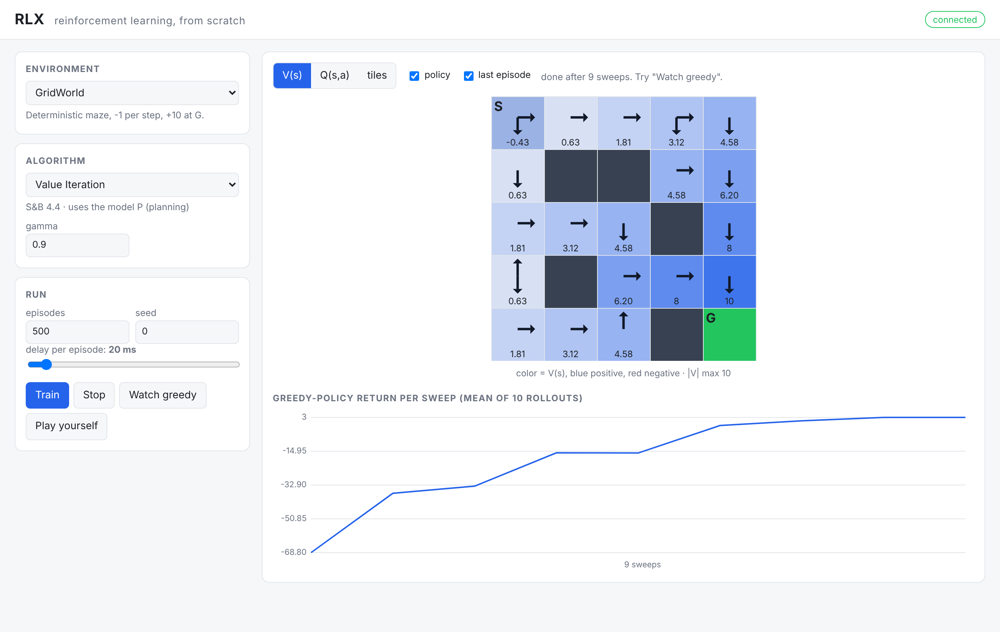

# RLX

**Reinforcement Learning, Deep RL and Multi-Agent RL algorithms, implemented from scratch**, plus a live web dashboard to watch them learn.




RLX has two goals:

1. **Clean reference implementations.** Every algorithm is written from first principles with NumPy, behind small, typed interfaces, and covered by tests.
2. **An educational playground.** Pick an environment and an algorithm, watch values and policy evolve live, replay the greedy agent, play the environment yourself, or draw your own grid world.

## Quick start

```bash
python -m venv .venv && source .venv/bin/activate
pip install -e ".[dev]"
pytest
python -m rlx.dashboard            # open http://127.0.0.1:8000
```

From Python:

```python
from rlx.algorithms import make_agent
from rlx.envs import CliffWalking
from rlx.training import History, evaluate, train

env = CliffWalking(seed=0)
agent = make_agent("value_iteration", env, gamma=1.0)
train(env, agent, callbacks=[History()])
print(evaluate(env, agent, n_episodes=1))   # -13.0, the optimal path along the cliff
```

## What's inside

| Area | Contents |
|---|---|
| `rlx/core` | `Env` / `DiscreteEnv` (with full model `P[s][a] = [(p, s', r, done)]`), `Agent`, `TabularAgent`, `PlanningAgent` |
| `rlx/envs` | `GridEnv` built from a text layout; GridWorld, FrozenLake 4x4 / 8x8, CliffWalking |
| `rlx/algorithms` | registry + one module per family (bandits, DP, MC, TD, n-step, planning) |
| `rlx/training` | `train` loop for online and planning agents, callbacks (`History`, `PrintLogger`, `EarlyStopping`, ...) |
| `rlx/dashboard` | FastAPI + WebSocket server, dependency-free canvas front-end |

## Roadmap

Tabular methods follow Sutton & Barto, *Reinforcement Learning: An Introduction* (2nd ed.).

- [x] Value Iteration (4.4)
- [ ] k-armed bandits: ε-greedy, UCB, gradient bandit (ch. 2)
- [ ] Policy Evaluation, Policy Iteration (4.1, 4.3)
- [ ] Monte Carlo control (5.4)
- [ ] SARSA, Q-learning, Expected SARSA (6.4–6.6)
- [ ] n-step SARSA (7.2)
- [ ] Dyna-Q (8.2)
- [ ] Deep RL: DQN, REINFORCE, A2C, PPO
- [ ] MARL: independent learners, centralised critics, value decomposition

Unimplemented algorithms ship as documented stubs; their tests in `tests/test_algorithms_learn.py` are skipped until they're written.

## License

MIT
